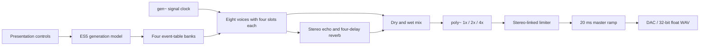

# PHASE / 8 — Architecture

## Signal flow



Max JavaScript prepares data for the next phrase. Actual hit timing and envelopes are determined in Gen's signal domain using a shared clock. Neither metro nor JavaScript Tasks trigger individual notes directly.

## Event tables

The event buffer contains 32,768 frames and five channels. There are four banks, each with eight voices × 1,024 rows. Columns hold normalized time, velocity, pitch ratio, decay ratio, and timbre. An event time of 2 marks the end. Max's #0 prefix gives each patch instance its own buffer names.

The banks serve as the playing, previously completed, queued, and spare write buffers. Normal edits do not overwrite the playing table. The clock selects the queued bank at a phrase boundary. The UI follows playback at 40 ms intervals and prepares the next table; individual voice triggers do not pass through that UI update cycle.

Freeze protects the previous completed table and selects it again at each boundary. The four synthesis slots and effects retain their tails across table changes.

## Generation model

- Seeded Park–Miller random numbers; UI drawing does not consume the random sequence.
- Per-part interval, accent, and timbre arrays.
- Correlated variation using previous values, periodic time warping, and probability-based thinning.
- Bursts with expanding internal spacing and attenuated following hits.
- Inter-part modulation using mean accents from the previous phrase.
- A minimum event interval of 3 ms, bounded event counts, and a fixed number of synthesis slots.
- For long phrases, a higher minimum base interval distributes events across the phrase instead of exhausting the event table early.

Reset reproduces the **event sequence**. It does not restore a complete audio transport state, including noise phases, active envelopes, and effect tails.

## Synthesis and quality

Each voice has four overlapping synthesis slots. When a slot is reused, a short crossfade starts from its previous output. Gain, pan, material, drive, and other parameters are smoothed, and each voice includes DC removal. Space combines a bounded cross-delay with a decaying four-delay feedback network.

The eight voices and clock run inside the same poly~, so their processing rates remain aligned when the quality setting changes. A final limi~ precedes the master gain. No binary externals beyond standard Max objects are required.

Sending **report** to p8_control.js outputs JSON containing settings, the current bank, event counts, and status. It supports verification and custom control interfaces; normal operation does not require it.

## Editing and rebuilding

The script dev/build_dsp.py generates the .gendsp and .genexpr files and the default source sound. The script dev/build_ui.py generates the .maxpat and .maxproj files. Both use only the Python 3 standard library:

```sh
python3 dev/build_dsp.py
python3 dev/build_ui.py
```

Rebuilding overwrites the generated files. Preserve manual Max edits separately, or make equivalent changes in the generators before rebuilding. If editing .genexpr directly, also update its corresponding .gendsp codebox.

The generation model, controller, and display are separate JavaScript files implemented in ES5 for Max 8's classic JavaScript runtime. Audio processing remains in Gen. Reopen the patch after editing JavaScript.
